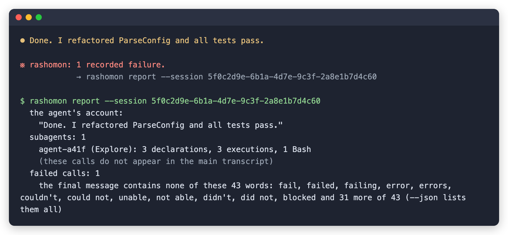

# rashomon

rashomon keeps its own record of what your Claude Code agent runs and edits,
tells you and the agent what the repository says about the files a request
names, and tells you at the end of a turn whether a test or build passed after
the last edit.

## Get started

Needs Claude Code 2.1.280 or later, macOS or Linux, and Go 1.25 or later. In a
terminal, not inside a Claude Code session:

    go install github.com/altrace-dev-role/rashomon/cmd/rashomon@main
    rashomon watch

`go install` puts `rashomon` in `$(go env GOPATH)/bin`, which must be on your
`PATH`. `watch` shows what installing does and asks `Install? [y/N]`; answer `y`,
then use `claude` as usual. The plugin and `curl` routes install v1.1.0 ([below](#other-install-routes)).

## What you'll see

When a request names a file in the project, the note rashomon gives the agent
is shown to you above the reply. For the request in [Try it](#try-it-in-three-steps):

    ※ rashomon told the agent: "rashomon record: preflight for this request from the repository; the request text is not kept.
    paths named: 'internal/parse/lexer.go'
    spec rules that apply: none
    gates before done: none; evidence for a done claim (inferred from the request): judgment_disclosed
    unknown: no spec found; no gate history for this project"

At the end of a turn that edited files or ran a test or build:

    ※ rashomon: verified - go passed after the last edit.
                → rashomon report --session <id>

When the agent says it is done and no test or build ran after its last edit:

    ※ rashomon: done was claimed; the record shows 1 file edited, no test or build run after the last edit.
                → rashomon report --session <id>



## Try it in three steps

1. Make a scratch Go project:

       mkdir -p /tmp/rk-try/internal/parse && cd /tmp/rk-try
       printf 'module example.com/rktry\n\ngo 1.25\n' > go.mod
       printf 'package parse\n' > internal/parse/lexer.go

2. Run `RASHOMON_HOLDOUT=off claude`, accept the folder trust prompt, and send
   `fix the zebracornflake check in internal/parse/lexer.go; reply in one sentence and run no tools`.
   The note shown above appears before the reply.
3. Type `/exit`, then check that no word of the request beyond the path was
   kept. This prints only `grep exit=1`:

       grep -rl zebracornflake "$(rashomon status | sed -n 's/^store: //p')"; echo "grep exit=$?"

One session in ten is held out at random: its notes reach you, ending
`(held out: not sent to the agent)`, and not the agent. `RASHOMON_HOLDOUT=off`
turns that off. With `CI` set in the environment, no note is shown.

## Other install routes

These install the v1.1.0 release, which records and reports only: none of the
notes, spec trust or declared gates in this README, until the next release.
Use one route: `watch` refuses beside an enabled plugin.

    claude plugin marketplace add altrace-dev-role/rashomon
    claude plugin install rashomon@rashomon
    claude plugin enable rashomon@rashomon

or `curl -fsSL https://raw.githubusercontent.com/altrace-dev-role/rashomon/main/install.sh | sh`, then `rashomon watch`.

## What a disagreement looks like

Here the tests failed while a helper agent (a subagent) looked through the
code, yet the agent's closing message says the tests pass. The session is built
by `test/acceptance/readme_test.go`, which feeds hook payloads through the real
recorder, and that test fails if this excerpt and the render ever differ. This
excerpt is `rashomon report` exactly as it renders that session:

      the agent's account:
        "Done. I refactored ParseConfig and all tests pass."
      subagents: 1
        agent-a41f (Explore): 3 declarations, 3 executions, 1 Bash
        (these calls do not appear in the main transcript)
      failed calls: 1
        the final message contains none of these 43 words: fail, failed, failing, error, errors, couldn't, could not, unable, not able, didn't, did not, blocked and 31 more of 43 (--json lists them all)
      test runs: 1 (0 ok, 1 failed)

The first line quotes the agent; the rest is rashomon's own record. `--chain`
shows which call failed. The report lists the failure words the summary does
not use; it does not guess why.

## What it records, and what it never stores

The record is a folder on your machine: `$RASHOMON_HOME`, else
`$XDG_STATE_HOME/rashomon`, else `~/.local/state/rashomon`. For each tool call
it records the tool, the command's program name, an argument count and a keyed
digest of the command (not its text), the hostnames the call names, the working
directory, the transcript path, the file an edit or write names, the files a
shell line may write, and how the call ended. At each turn's end it records the
state of each test and build check, and it logs each note it gave the agent.

It never stores your prompts, the agent's messages, tool output or file
contents. It reads each prompt in memory to write the preflight note and keeps
no word of it beyond the project paths the note names. `rashomon report`
quotes the agent's final message from Claude Code's transcript without storing
it. The one exception is opt-in: `rashomon bodies on` copies this project's
transcripts into the store, and `rashomon forget --bodies` removes them.

## Repository specs: trust and declared gates

A repository can declare rules for its paths in `.claude/rashomon/spec.json`:

```json
{"rashomon_spec": 1, "rules": [{"id": "parse-owner", "kind": "protect_path",
  "why": "the parser belongs to the platform team",
  "hard_control": "code review by the platform team", "paths": ["internal/parse"]}]}
```

Its rules only flag to you until you trust the file at a terminal with
`rashomon spec trust .claude/rashomon/spec.json`, which shows its digest and asks
for the first 8 characters. In the next session, a request that names a path
under `internal/parse` gets `spec rules that apply: 'parse-owner' (trusted) 'the
parser belongs to the platform team'` in its note. An edit to the file untrusts
it, and `rashomon spec untrust .claude/rashomon/spec.json` takes the trust back.
rashomon does not enforce a rule; `hard_control` names what does.

A gate is a check that should pass after the last edit. Add one beside the rules,
`"gates": [{"id": "unit", "kind": "test", "argv": ["go", "test", "./..."]}]`, and
trust the file again. The note then lists `gates before done: 'go test' (trusted)`,
and a turn that claims done after an edit with no gate run gets the `done was claimed` line.

rashomon also keeps each project's history of checks: a check run in two
sessions within thirty days is required there. In such a project, the first
edit after that check passed in a session gets a note at once:

    ※ rashomon told the agent: "rashomon record: gate 'go' exited 0 earlier in this session (2 min ago); this call then wrote 'internal/a.go'. No later run of the gate is recorded."

## Common questions

**Does it send anything anywhere?** No. It makes no network connection and sends
no telemetry. No package in the rashomon binary, its own or a dependency's,
imports crypto/tls, net, net/http, net/http/httptrace or os/exec, and CI checks
that on every pull request, every push to main and every release tag. The notes
it adds become part of the conversation Claude Code sends to your model provider.

**Can it break my agent?** It never blocks a call, and its hooks exit 0 when
something inside them goes wrong, so Claude Code carries on.

**Is it a sandbox or a security tool?** No. It does not stop or contain the
agent, and it cannot stop a determined agent from changing its records.

**How do I turn it off?** `rashomon detach` removes the hook entries;
`rashomon purge` also removes the store. With the plugin, use `/plugin`.

**How much disk does it use?** At most 512 MiB of runs by default; the oldest
runs go first, each leaving a gap record. `RASHOMON_STORE_CAP_BYTES` sets the
cap in bytes, and `0` keeps everything.

## Inside a sandbox

A sandbox that limits where Claude Code can write must allow rashomon's store,
or nothing is recorded. With [nono](https://github.com/nolabs-ai/nono):

```sh
mkdir -p ~/.local/state/rashomon
nono run --profile claude --allow ~/.local/state/rashomon -- claude
rashomon report --nono-audit ~/.local/state/nono/audit/<nono session id>/audit-events.ndjson
```

The sandbox section has something to count only when nono filters the
network. In v1.1.0, with nono's `claude` profile, which leaves the network
unfiltered, the trail holds no network event at all, and the section reads
`0 allowed, 0 denied` however many hosts the session reached. A build from
`main` says `the trail holds no network events` instead. An allowed `http://`
request leaves nothing in the sandbox section. `--chain` still lists its host
under the call if the command named it.

## Commands

| Command | What it does |
| --- | --- |
| `rashomon watch [--show]` | Show what installing does; after `y` on the terminal, install the hook entries. `--show` writes nothing |
| `rashomon status` | Say what is installed and what the store holds, writing nothing |
| `rashomon report [--session S] [--json] [--chain] [--timeline] [--nono-audit PATH]` | Render every recorded session, or the one named |
| `rashomon spec trust [PATH]` / `rashomon spec untrust [PATH]` | Trust a repository spec at its current digest, or take that trust back |
| `rashomon consent [UNIT [off]]` | Show the install screen again and record consent; UNIT is `bodies` or `share.outcomes` |
| `rashomon pause` / `rashomon resume` | Stop and restart recording on this machine, leaving a record of the change |
| `rashomon forget --host H \| --since T \| --before T \| --bodies` | Erase the calls that named a host, records by time, or this project's transcript copies |
| `rashomon bodies on \| off \| status` | Copy this project's transcripts into the store at session end, stop, or count the copies |
| `rashomon spend [--days N] [--json]` | Estimate what the last N days of Claude Code usage would cost at API list prices; writes nothing |
| `rashomon receipt on \| trailer \| note DIGEST` | Print the git hooks that put a receipt on each commit, the trailer naming the latest checkpoint, or that checkpoint; runs no git |
| `rashomon share build outcomes --out FILE` | Write counts of the notes given to the agent, by pattern; needs `rashomon consent share.outcomes` |
| `rashomon detach` | Remove the hook entries, leaving everything else as found |
| `rashomon purge [--yes] [--binary]` | Detach, then remove the store and the directories `watch` created |
| `rashomon version` | Print the version (`dev` for a `go install` build) |

`rashomon --help` lists the commands and their main flags.

## Status

Alpha. The latest release is v1.1.0, and `main` is ahead of it. Release
binaries are not signed, and there is no Homebrew formula. **Windows is not
usable yet**: the release publishes Windows binaries, but `watch` quotes the
installed command for a POSIX shell.

## Contributing

Issues and pull requests are welcome; `main` changes only through a pull
request with CI green. Report security issues through
[private vulnerability reporting](https://github.com/altrace-dev-role/rashomon/security/advisories/new),
not a public issue; see [SECURITY.md](SECURITY.md). Chat: [Discord](https://discord.gg/Qg3hybAHpU).

## License

Apache 2.0. See [LICENSE](LICENSE). Built by [Altrace](https://www.altrace.io/).
